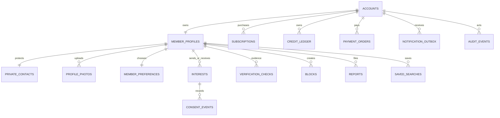
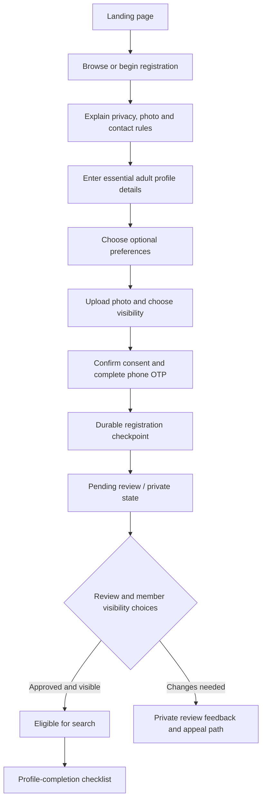

# ManaVivaha.in — Product, Trust & Experience Blueprint

**Status:** current-state audit plus staged target design<br />
**Prepared:** 13 October 2026<br />
**Brand:** Mana Vivaha / మన వివాహ — this document does not rename the brand, domain, or legal entity.

> This is an implementation brief, not a claim that every target capability already exists or that production has passed release QA. “Current” means verified in this repository; “Target” means a proposed, staged design. A local test cannot prove production data, provider delivery, identity, or member outcomes.

## 0. Product decision principles

1. **Trust before conversion.** Never use fake member counts, fabricated testimonials, misleading verification badges, urgency timers, or hidden recurring charges.
2. **Member agency.** A person chooses what to publish, whom to contact, which preferences to save, and whether to receive reminders.
3. **Consent is not a paid feature.** Credits or subscriptions must never bypass the profile owner's decision to accept an interest.
4. **Explain, don't pronounce.** Show which member-entered facts and explicit preferences were compared. Do not declare that two people are “perfect,” predict marriage, or show an unvalidated compatibility percentage.
5. **Collect less.** Ask for a field when the member understands why it is needed. Keep optional information optional and give a clear privacy explanation beside sensitive fields.
6. **Human review has a scope.** Phone OTP, photo review, and government-ID review are separate evidence; none is a blanket identity or safety guarantee.
7. **No silent data reset.** Deploy, migration, backup, and restore paths must preserve source data, validate before writes, and provide a tested rollback.
8. **Respectful growth.** Improve onboarding and referrals without nagging, contact scraping, forced sharing, or misleading premium prompts.

## 1. Verified current-state audit

### Strengths already present

- Bilingual Telugu/English Next.js App Router frontend, FastAPI backend, member registration, search/matches, profiles, interest requests, plans, reporting/blocking, profile privacy controls, owner tools, and public information pages.
- Registration requires an adult age (18–60 in the current request model), a technically valid photo, explicit photo consent, and a durable core-store checkpoint before success is returned. The registration flow uses multiple steps and a local draft.
- Contact reveal is consent-gated by an accepted interest; credits do not override consent. Owner/admin routes use server-side authorization.
- Verification copy distinguishes phone OTP, photo review, and ID review; public profile facts are described as member-submitted rather than guaranteed.
- `topmatch.py` compares available facts and saved preferences without returning a compatibility score. Missing facts remain unknown. Approved profiles and privacy/block checks are applied in the match path.
- Public testimonials are disabled unless real, consented testimonials are available. Support/legal contact defaults are not fabricated.
- The in-app backup/restore path now validates core shape, refuses unmarked empty or identity-duplicate snapshots, and requires explicit confirmation when active core record counts would fall.

### Material limitations and risks

- **Persistence is JSON, not a production relational database.** The core store and multiple satellite JSON files are loaded into process memory. The production Compose file intentionally uses one backend worker. This is a single-node system; horizontal scaling, concurrent multi-worker writes, and high availability are not supported.
- **The largest service router is broad.** `backend/main.py` contains many route families. Keep future work in small domain modules with stable contracts and regression tests rather than growing that router further.
- **Current matching is explainable, not learned AI.** Results are based on approved/visible eligibility, explicit filters/preferences, factual comparisons, and recency. Do not market the current system as an AI that predicts relationship success.
- **Provider readiness is unverified here.** Local code and tests do not establish production SMS/OTP delivery, payment settlement/refunds, Telegram/WhatsApp delivery, or a real operator response workflow.
- **Visual QA is incomplete.** Lint/type checks do not prove there is no overlap or overflow on every Android, iPhone, tablet, foldable, browser zoom, or assistive-technology combination. A viewport/device test matrix and real-device review remain release work.
- **Brand/legal identity is deployment-controlled.** Keep `ManaVivaha.in` and its current configured domain until the owner authorizes any brand/domain/legal-entity change.

### Evidence rule

Only publish counts, “active” states, delivery claims, verification badges, refund timing, and support availability when there is a measured source and a tested owner-controlled configuration. Do not turn local fixtures or queued messages into public proof.

## 2. Website architecture

### Current implementation

```text
Browser / PWA
  └─ Next.js App Router (frontend/src/app, React + TypeScript + Tailwind)
       ├─ Public: home, matches/search, caste/location guides, blog, vendors, pricing
       ├─ Member: registration, profile, interests/requests, referral, saved tools
       └─ Owner: moderation/operations pages behind admin authorization
            │ same-origin /api/* proxy
            ▼
       FastAPI application (backend/main.py + focused domain modules)
            ├─ Auth / consent / visibility / rate limits
            ├─ Registration, search, matching, interests, payments, moderation
            ├─ Core JSON snapshot via backend/db_store.py
            └─ Satellite JSON/JSONL stores, media root, optional providers
```

The deployed production configuration is single-backend-worker by design. PostgreSQL and Redis must not be described as the current system of record unless an implementation and migration are actually completed and verified.

### Target architecture, staged

```text
Web/PWA ── same-origin API ── FastAPI domain services
                                  │
                      service/repository interfaces
                          ├─ PostgreSQL (transactional records)
                          ├─ private object storage (media)
                          ├─ outbox/worker (notifications)
                          └─ privacy-minimized analytics
```

A future PostgreSQL migration is a separate project, not an opportunistic deploy. First map every existing JSON file and media directory; make an encrypted off-host backup; restore it to an isolated clone; validate row/file counts and access behavior; migrate with idempotent scripts and a rollback plan; only then cut over. Keep the current validated JSON source intact until the owner approves and the clone has passed verification.

### Route families

| Surface | Purpose | Index policy |
|---|---|---|
| `/`, `/castes/*`, `/districts/*`, `/blog/*`, `/channels` | Trustworthy discovery and educational content | Index only when each page has unique, accurate, useful content |
| `/matches`, `/search/*` | Search and member profile details | Noindex by default; profile-level indexing is not enabled and must not be enabled without explicit member opt-in and privacy review |
| `/register`, `/login`, `/me`, `/requests` | Account and member actions | Noindex for account-specific screens |
| `/pricing`, `/safety`, `/privacy`, `/terms`, `/refund` | Transparent decision and policy information | Indexable; owner/legal review required for policy claims |
| `/admin/*`, `/control/*`, `/owner`, APIs | Restricted operations | Never index; server authorization remains mandatory |

## 3. Database schema

### Current core JSON contract

`backend/db_store.py::snapshot` persists one core object with:

- `storage_format`, `saved_at`
- `users[]`, `interests[]`, `payments[]`
- `otps{}`, `verified_phones[]`
- `views[]`, `saves[]`, `digest[]`

Satellite JSON/JSONL files hold additional domains. This is the current storage contract; the schema below is a **future relational proposal**, not a migration or a claim about the live database.

### Proposed relational model

| Table | Key fields / constraints | Privacy and integrity notes |
|---|---|---|
| `accounts` | `id UUID PK`, normalized `phone_lookup_hash UNIQUE`, credential hash, account status, timestamps, `version` | Store credentials with a modern password KDF; never return hashes/tokens. Keep revocation durable. |
| `member_profiles` | `id UUID PK`, `public_id UNIQUE`, `account_id FK UNIQUE`, `profile_for`, member-entered facts, `visibility`, `review_status`, timestamps | Only approved, active, visible profiles enter public search. Use optimistic versioning. |
| `private_contacts` | `profile_id PK/FK`, encrypted phone/email, contact update timestamps | Encrypt separately from public profile data; decrypt only in a consent-authorized contact response. |
| `profile_photos` | `id UUID PK`, `profile_id FK`, private object key, review state, visibility, sort order | No public object keys for private/pending/rejected photos; apply deletion/retention policy. |
| `member_preferences` | `profile_id PK/FK`, age/location/work/community/other chosen fields, visibility and `updated_at` | Record whether a preference is hard or soft; do not infer sensitive preferences. |
| `interests` | `id UUID PK`, `from_profile_id FK`, `to_profile_id FK`, state, idempotency key, timestamps; unique active pair | State transitions are explicit; use transactions and idempotency to avoid duplicate charges/requests. |
| `consent_events` | `id UUID PK`, `interest_id FK`, actor, action, purpose, timestamp, policy version | Append-only evidence for sending/accepting/withdrawing consent; never infer consent from payment. |
| `verification_checks` | `id UUID PK`, `profile_id FK`, check type, scoped result, reviewer, evidence reference, timestamps | Keep phone, photo, and ID checks separate; record scope and expiry; minimize retained evidence. |
| `blocks` | `(actor_profile_id, blocked_profile_id) UNIQUE`, timestamps | Apply in both directions to search, recommendations, and contact routes. |
| `reports` / `moderation_cases` | report, reason, severity, queue state, assigned reviewer, decision, appeal timestamps | Restrict access; keep an auditable case history and documented escalation process. |
| `subscriptions` / `credit_ledger` | subscription state plus immutable credit entries, source, expiry, idempotency key | Never mutate balances without a ledger event; preserve refunds/reversals and reconciliation evidence. |
| `payment_orders` | internal order ID, provider order/payment IDs (`UNIQUE`), amount/currency, verified state, webhook idempotency key | Do not grant benefits from a client callback alone; verify signatures, amount, currency, replay, and refunds. |
| `saved_searches` | `id UUID PK`, `profile_id FK`, filters JSON, alert consent, frequency | Notifications are opt-in, rate-limited, and easy to stop. |
| `notification_outbox` | `id UUID PK`, recipient, channel, template version, state, attempt count, provider reference | A queued/sent status is not proof of delivery or reading. Never store unnecessary message content. |
| `audit_events` | actor, action, target, reason, timestamp, request correlation ID | Append-only, access-restricted, retention-limited; exclude secrets and raw OTP/contact payloads. |
| `referrals` | referrer, referred profile, eligible order, state, payout/credit event | Reward only a defined, verified eligible event; handle refund/chargeback reversal and self-referral abuse. |

Important indexes for a future search store: `(review_status, visibility, state, district, gender)`, `created_at`, normalized filter fields used by approved queries, unique provider transaction IDs, and unique idempotency keys. Search indexes must not expose private phone, OTP, credential, moderation, or hidden-preference data.



## 4. User flows

### Registration and profile completion



**Product improvement:** preserve the existing multi-step, resumable form, but progressively ask for high-value fields first; label optional sections, show why sensitive fields are requested, maintain clear save/exit, and let the member preview exactly what is public. Completion prompts must not block account access or imply that more sensitive data automatically means a better match.

### Interest, consent and contact

```mermaid
sequenceDiagram
  participant A as Member A
  participant W as Mana Vivaha
  participant B as Profile owner B
  A->>W: Search and review member-submitted facts
  A->>W: Send interest (free allowance or visible credit cost)
  W->>B: In-app request / configured notification
  B->>W: Accept, decline, or leave pending
  W-->>A: Update request status
  alt B accepts
    A->>W: Open accepted request in account
    W->>W: Re-check current consent, block state, profile status
    W-->>A: Reveal authorized contact details
  else B declines, blocks, or withdraws
    W-->>A: Keep contact hidden; apply published credit/refund policy
  end
```

Re-check consent and block state on every contact read, not only when the interest is first accepted. Send no unmasked contact data to public search cards, analytics, bot logs, or error telemetry.

### Payment and referral

```mermaid
flowchart LR
  A[Member chooses plan] --> B[Show amount, credits, expiry, refund terms]
  B --> C[Create idempotent server order]
  C --> D[Provider checkout]
  D --> E[Verify provider signature and amount]
  E --> F[Reconcile webhook idempotently]
  F --> G[Append credit ledger event]
  G --> H[Show receipt and balance]
  H --> I[Support, refund, or dispute route]
```



Never tell a member payment is complete from a browser redirect alone. Keep live payments disabled until owner-controlled credentials, sandbox checks, webhook replay tests, and refund reconciliation are complete.

## 5. Explainable matchmaking / AI roadmap

### Current behavior

The current comparison path reports overlapping/different member-entered facts and checks explicitly saved preferences. It deliberately does **not** return an invented compatibility percentage, “marriage success” probability, or mutual-interest prediction. Candidate ordering is based on explicit filtering and recency, not an AI model.

### Proposed recommendation pipeline

1. **Eligibility gates:** adult accounts; profile active, approved, and visible; opposite profile category supported by the member's chosen search; no block/report safety exclusion; photo/contact visibility respected. Unknown or unreviewed profiles do not receive a verification badge.
2. **Member-controlled constraints:** apply only fields the member explicitly selected as “must have.” Explain filters before applying them and provide one-tap removal. Do not silently add defaults based on caste, income, education, horoscope, appearance, or prior clicks.
3. **Soft preference ordering:** compare chosen “nice to have” values. Missing candidate data is `unknown`, not a mismatch. Do not infer religion, caste, salary, health, personality, intent, or family approval.
4. **Transparent reasons:** render a small number of factual labels such as “Within your saved age range” or “Location matches your saved preference.” Show “not listed” where appropriate. Never call these reasons proof of suitability or identity.
5. **Exploration and fairness:** rotate eligible profiles to avoid only showing the same high-activity accounts; cap promotional exposure; label paid promotion separately and do not let payment alter a claimed compatibility result.
6. **Feedback:** allow “not relevant,” hide, block, and report. Use feedback to improve the member's own filters, not to infer sensitive traits or train on private conversations without explicit consent.
7. **Future ML gate:** only consider a model after consented, sufficiently representative data, privacy review, bias evaluation, explainability tests, opt-out, retention rules, human oversight, and a documented rollback. No model should predict marriage success or override consent.

**Current ranking must remain deterministic and testable.** The proposed pipeline does not justify changing ranking weights until member research and fairness review establish that a change improves satisfaction without reducing exposure for a protected or less-active group.

## 6. Homepage design and conversion strategy

### Above-the-fold design

- One honest value statement for Telugu families, one primary “Create your free profile” action, and a compact, optional search panel.
- Search asks only for target profile category, adult age range, and region; deeper filters remain in search. No forced login to browse public, privacy-safe details.
- Place the contact-consent and OTP scope beside the action: OTP confirms phone-number access, not identity; contact details follow owner acceptance.
- Keep actual member cards below the hero only when they are approved, public, and photo-permitted. Never use generated/staff demo people as real profiles.
- Use the existing wedding visual as decorative context, not as evidence of a member or a claim about outcomes.

### Page sequence

1. Hero + compact search + safety note.
2. Public, approval/privacy-gated member cards (or a respectful empty state; no fabricated inventory count).
3. Three short steps explaining search → interest → owner acceptance/contact.
4. Evidence-scoped trust and photo-privacy explanation.
5. Transparent plan summary and link to complete terms.
6. FAQ covering consent, cost, OTP scope, photo visibility, deletion/reporting.
7. One final registration action.

Avoid inserting unrelated vendors/ads between the first search and the explanation of trust. Keep optional vendor monetization clearly separated from member recommendations.

## 7. Mobile-first layout and interaction rules

| Viewport | Primary layout | QA focus |
|---|---|---|
| 320–359 px | One-column, compact labels, no fixed-width cards | Long Telugu words, safe area, button labels, horizontal overflow |
| 360–479 px | One-column search and cards | 44px targets, 16px form controls, keyboard focus, sticky CTA clearance |
| 480–767 px | One-column hero, optional two-column form fields | Folded keyboard, bottom sheet height, scrolling and safe areas |
| 768–1023 px | Tablet / narrow foldable; one or two columns only when readable | Avoid narrow sidebars, portrait/landscape resize, split-screen |
| 1024–1279 px | Two-column hero; compact filters and cards | Text measure, fixed navigation, filter panel width |
| 1280–1919 px | Centered content with a stable max width | Avoid over-wide paragraphs, excessive empty space, large image payloads |
| 1920+ px | Keep content centered; do not stretch forms/cards | Readability and consistent hierarchy |

**Acceptance checks:** no horizontal page overflow; no overlapping fixed CTA/header/dialog; controls remain usable with 200% zoom and device text scaling; keyboard and screen-reader access; reduced motion respected; images have stable aspect ratios; loading/error/empty states are designed; touch targets are at least 44×44 CSS px where practical. Run Playwright screenshots at 320, 360, 390, 430, 768, 1024, 1280, and 1920 px plus real Android/iPhone/foldable checks before claiming “verified on every screen.”

## 8. Premium subscription and growth strategy

### Current price surface

Current configured examples in the app are registration free, the first 3 interest requests free, then ₹99/5, ₹199/12, ₹299/25, and ₹499/50 request credits. These are the current code/config values, not a market-research conclusion. No price change is authorized by this brief.

### Trust-first value ladder

- **Free:** create/profile preview, basic search, first 3 interest requests, privacy controls, report/block, clear request status.
- **Small plans:** add request credits with amount, number of credits, expiry, and decline/refund treatment visible before checkout.
- **Premium value (future, test before launch):** explicitly opt-in alerts, profile completeness guidance, and optional human-assisted support with a clearly stated service scope and response expectation. Saved searches and expanded filters are now available as account-private features; notification alerts remain off for new searches unless the member explicitly opts in.
- **Promotion:** if boosts exist, mark each card “Promoted” and keep its placement separate from match-relevance explanations. Never sell a trust badge or contact consent.
- **Retention:** helpful opt-in saved-search digests, quiet hours, frequency controls, and one-click unsubscribe; no fear-based renewal prompts.
- **Referral:** reward only on a documented eligible event; show status and reversal rules; never require importing a phone book or mass-sharing a link.

Measure paid conversion alongside complaints, chargebacks, refund time, declined-interest experience, and free-member outcomes. A conversion increase is not a success if member trust falls.

## 9. Trust, verification and safety system

| Label | What it may say | What it must not imply |
|---|---|---|
| Phone OTP | “Phone-number OTP completed” | Identity, age, ownership of every profile fact, safety, or intent |
| Photo review | “Submitted photo reviewed” plus scope/date where useful | Government-ID match, liveness, sole ownership, or guarantee the pictured person will attend |
| Government-ID review | Exact document review state and scope | Criminal/background clearance, current address, or verification of every profile fact |
| Member-submitted | A fact the account entered | Independent verification |
| Profile approved | Moderation decision and policy scope | A guarantee of truth or a guarantee of good conduct |

Trust workflow: rate-limited registration → explicit photo/data consent → technical validation → scoped staff review → private pending state → approval/visibility controls → ongoing report/block moderation → appeal/deletion path → periodic audit of reviewer access. Store the minimum evidence needed, restrict staff access, record decisions, and state how long evidence is retained. Safety copy should encourage independent first-meeting precautions and avoid false assurances.

## 10. Component and service architecture

### Frontend components

```text
AppShell
├─ SiteHeader / mobile navigation / language selector
├─ Main content
│  ├─ Home: CinematicHero + HomeMatchSearch + member cards + pricing/FAQ
│  ├─ Search: FilterBar + mobile FilterSheet + ProfileCard + RecordedCheckLabel
│  ├─ Profile: ProfileFacts + PhotoVisibility + InterestAction + ConsentContactGate
│  ├─ Registration: Stepper + autosaved fields + PhotoFlow + ConsentSummary
│  └─ Member area: RequestInbox + SavedSearches + CreditLedger + PrivacyControls
└─ SiteFooter / safety links / opt-in sticky action
```

Keep components small and evidence-aware: `PhoneOtpBadge`, `PhotoReviewBadge`, and `IdReviewBadge` should be separate components or share a component with explicit `scope`; do not use a single generic green “Verified” badge. Keep private fields out of generic `ProfileCard` props.

### Backend domains

`auth`, `profiles`, `search`, `matching`, `interests/consent`, `media`, `verification/moderation`, `payments/ledger`, `referrals`, `notifications/outbox`, `admin/audit`, and `analytics`. Define request/response schemas at each boundary; use idempotency for money/interest mutations; require owner/admin authorization on every private route; centralize transaction/save logic and failure handling.

## 11. SEO and discovery roadmap

### Technical baseline

- Preserve the canonical `https://manavivaha.in` configuration unless an owner approves a domain change.
- Keep search, member account, profile editor, requests, admin, and control surfaces noindex. Do not put private member IDs or details in a sitemap.
- Use server-rendered, unique metadata for public guides and editorial content; set canonical, Telugu/English language alternates where actual localized pages exist; avoid duplicate thin pages.
- Keep JSON-LD truthful and sanitized. Never emit unverified legal identity, address, “verified” population counts, reviews, or service coverage.
- Programmatic community/location pages must contain useful unique guidance and accurate availability; remove empty/near-duplicate pages from the sitemap.
- Optimize poster/video delivery, lazy-load below-fold imagery, provide descriptive alt text for informational images, and keep profile-photo alternatives privacy-safe.

### 0–30 / 30–60 / 60–90 days

- **0–30:** audit indexability/canonicals and localized metadata; measure Search Console coverage; review every programmatic page for thin/duplicate content; ensure search query parameters canonicalize to the unfiltered route.
- **30–60:** publish owner-reviewed Telugu/English safety, family-introduction, privacy and process guides; add internal links from relevant caste/district pages to search without promising inventory.
- **60–90:** review qualified organic registrations and content usefulness; consolidate pages with no distinct value; run performance and accessibility audits on mobile. Do not gate essential safety copy behind registration.

## 12. Metrics and ethical experimentation

Track a privacy-minimized funnel: landing → search started → profile viewed → registration started → step completion → photo consent/upload → OTP outcome → review outcome → interest sent → accepted/declined → contact access → paid order/refund. Aggregate where possible; never put phone numbers, OTPs, passwords, raw profile text, or private preference values in analytics.

**North-star candidate:** member-reported useful, respectful introductions per active member—not raw swipe count, notification volume, or premium revenue alone.

Guardrails: abuse/report rate, block rate, photo-consent withdrawal, OTP failure, review/appeal time, unresolved support cases, declined/expired credit handling, refunds/chargebacks, message opt-outs, and profile deletion completion. A/B tests require a written hypothesis, a trust/safety guardrail, accessibility review, a defined stop condition, and no dark patterns.

## 13. Delivery and release gates

### Immediate implementation in this worktree

- Added a compact bilingual hero search for profile category, adult age range, and region; it routes to existing match filters and places scoped privacy copy beside the action.
- The decorative hero film now stays paused on small screens and when the browser requests reduced motion or data saving; the animated canvas is skipped on small screens/data-saving mode.
- Reduced competing hero actions so registration and browsing/search each have one clear path.
- The `/matches` route now hydrates every supported search filter from the submitted query, validates typed values, ignores unknown keys, and normalizes repeated multi-select values; focused parser tests cover the home-search parameters and invalid-input boundaries. Browser-level interaction still needs visual/device verification.
- Moved the optional vendor showcase below the core member trust, pricing, and FAQ sequence so it does not interrupt the primary introduction journey.
- Simplified the mobile drawer around secondary journeys: the fixed bottom bar keeps Home, Matches, Pricing, Referral, and Account; the drawer removes duplicate links, surfaces Safety, and collapses the longer tools/resources list.
- Replaced the matches-card heart’s temporary client-only toggle with the existing owner-authenticated shortlist API: saved state loads per account, writes are guarded by the member token, signed-out users get a login path, and request failures can be retried. Shortlist IDs are not duplicated into localStorage; session-only IDs now resolve through the shared auth helper.
- Search now requests 24 profiles per page instead of rendering up to 100 cards at once, with an explicit load-more/retry control, duplicate-ID protection between offset pages, cancellation of stale requests when filters change, and a 15-second request timeout. API limit/offset behavior has a regression check; real-device render performance still needs measurement.
- Raised key mobile navigation, filter, shortlist, and dismiss controls to at least 44 px and added an accessible label to removable filter chips; visual verification on real device sizes remains pending.
- Completed the missing Matches controls for religion, sub-caste, education, salary/height ranges, Rasi, and member-entered Dosham on mobile and desktop. The API now applies sub-caste and Rasi filters; missing Dosham is kept unknown rather than silently treated as “No.” Horoscope fields are filtering facts only—no compatibility score or prediction is produced.
- Added an account-private saved-search manager with apply/delete, a 20-search cap, retryable loading, and an explicit notification-off default. New saves send `alert: false`; owners can turn off any legacy enabled alert. Backend normalization/matching now covers the visible filters, and regression tests verify OR semantics, privacy/unknown-data behavior, alert defaults, and owner controls. Alerts require an explicit per-search consent timestamp; legacy `alert=true` rows without recorded consent are paused. Saved searches are not copied to localStorage.

### Next engineering phases

1. **P0 — data and release reliability:** retain the one-worker rule; maintain volume/backup/restore checks; add a CI-safe backend test entry point; do not migrate live records until an isolated restore drill passes.
2. **P1 — design-system consistency:** document type scale, spacing, colors, control states, error/empty/loading patterns; refactor shared buttons/forms/cards gradually with snapshot and accessibility checks.
3. **P1 — responsive QA:** add Playwright viewport screenshot and keyboard/axe coverage; manually review Android, iOS Safari, tablet, foldable/split-screen, large text, reduced motion, and poor-network behavior.
4. **P2 — onboarding and search research:** observe consented usability sessions; measure step drop-off without collecting unnecessary sensitive attributes; test optional-field grouping and search defaults.
5. **P2 — explainable matching:** preserve preference controls and factual reasons; evaluate candidate exposure and member feedback before any ranking change. Do not introduce an opaque model before consented data and bias review.
6. **P3 — database migration:** only after scale/concurrency evidence and owner authorization; build PostgreSQL migrations on a cloned dataset, reconcile all records and media references, and preserve a documented rollback to the untouched source volume.
7. **P3 — provider and growth validation:** stage SMS/payment/webhook/refund/notification flows with owner-controlled test credentials; prove retries, duplicate handling, delivery-status truth, and stop controls.

### Production release gate

The local code and tests do not establish an authorized live host, persistent-volume mapping, off-host backup, DNS/TLS, provider delivery, legal approval, visual device coverage, or member support operation. Keep production **NO-GO** until those are verified by the owner/operator. Do not claim “perfect,” “verified on every device,” “AI-powered,” or “most trusted in India” without the evidence and operational capability to substantiate it.
